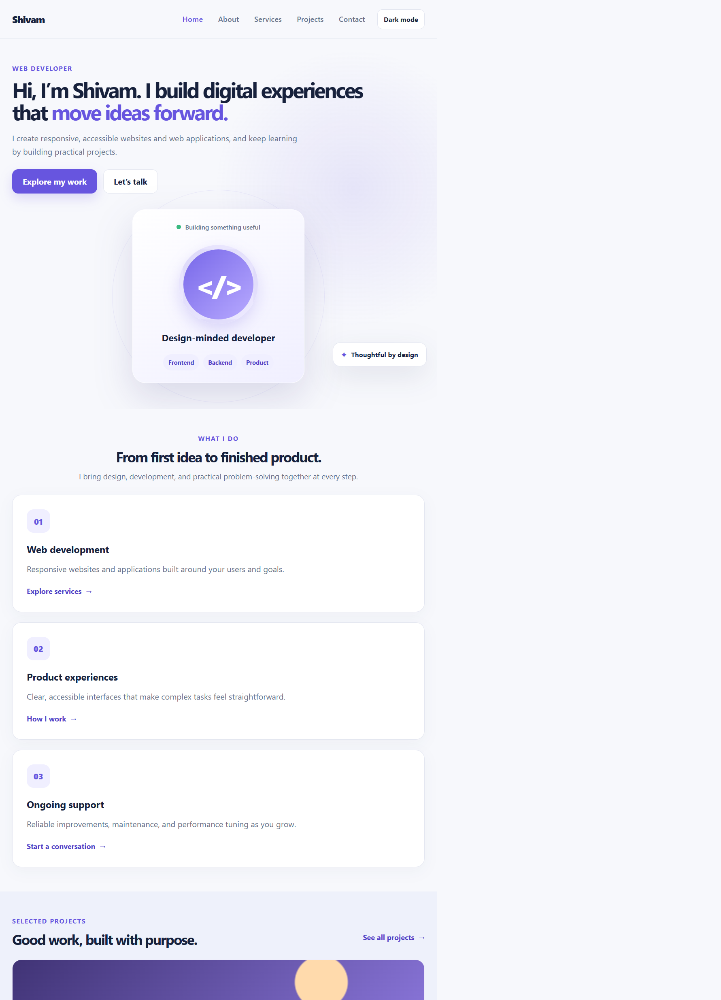
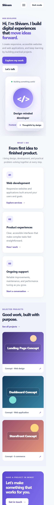

# Shivam's Portfolio

A responsive, multi-page developer portfolio built with semantic HTML5, CSS Flexbox and Grid, and vanilla JavaScript. It includes a saved light/dark theme, a mobile navigation menu, smooth anchor scrolling, and accessible contact-form validation.

No packages, build process, or backend are required.

## Run locally

In VS Code, open **Terminal → New Terminal** and run:

```powershell
py -m http.server 8000
```

If `py` is not available, use `python -m http.server 8000`. Open <http://localhost:8000> in your browser and press **Ctrl+C** in the terminal to stop the server.

If the terminal starts in another folder, change to the folder where you saved this project:

```powershell
cd "C:\path\to\Task-1"
```

You can also open `index.html` directly or use the VS Code **Live Server** extension.

## Pages

- [Home](./index.html) — introduction, services, selected work, and contact call to action.
- [About](./pages/about.html) — background, values, and technologies.
- [Services](./pages/services.html) — development, design, maintenance, and performance services.
- [Projects](./pages/projects.html) — clearly labeled project concepts to replace with your own work.
- [Contact](./pages/contact.html) — validated inquiry form and contact details.

See the [sitemap](./docs/SITEMAP.md), [wireframes](./docs/WIREFRAMES.md), and [accessibility notes](./docs/ACCESSIBILITY.md).

## Screenshots

| Desktop home | Mobile home |
|---|---|
|  |  |

The desktop and mobile captures use the same system-default theme. Use the theme switch in the header to preview the other theme.

## Features and accessibility

- Responsive layouts using CSS Grid and Flexbox.
- Toggleable light/dark theme, saved for the next visit; follows the operating-system theme until changed.
- Keyboard-operable mobile navigation with Escape-to-close support.
- Contact form validation with visible, field-associated errors and an announced status message. This front-end demo does not send or store messages.
- Semantic page landmarks, one main heading per page, a skip link, visible keyboard focus, descriptive labels, and reduced-motion support.
- CSS smooth scrolling with respect for reduced-motion preferences.

Read [ACCESSIBILITY.md](./docs/ACCESSIBILITY.md) for the checks and known limitations.

## Project structure

```text
Task-1/
├── assets/
│   ├── css/          # Shared and responsive styles
│   └── js/           # Theme, navigation, and form validation
├── docs/             # Sitemap, wireframes, and accessibility notes
├── pages/            # About, services, projects, and contact pages
├── screenshots/      # Desktop and mobile preview images
├── index.html
└── README.md
```

## GitHub

This portfolio is published at [github.com/Shivam-111/internship-portfolio](https://github.com/Shivam-111/internship-portfolio). To publish future updates, run these commands from this project folder:

```powershell
git add .
git commit -m "Update portfolio"
git push
```

## Follow-up

The contact form currently validates in the browser but does not send or store messages. Add a real contact method or connect a form service before relying on it for inquiries. Project cards are labeled as concepts; replace them with finished work when available.
